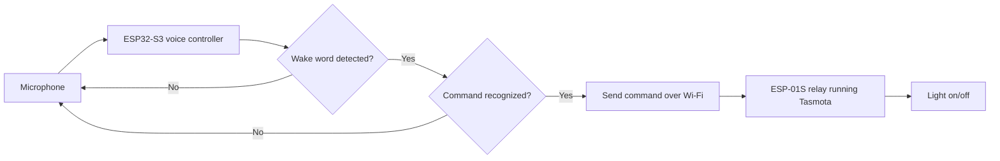

# Jarvis: Voice-Activated Room Light

> A hardware voice-activation project: say **"Hey Jarvis"**, then a command, and a Wi-Fi relay switches the lights in my room


<!-- TODO: add a short GIF/video of me saying "Hey Jarvis" and the light turning on/off, then uncomment the line below. This is the single most impactful thing on the page. -->
<!--  -->

---

## Overview

Jarvis is a voice-controlled light switch built around offline speech recognition. It listens for the wake word **"Hey Jarvis"**. Once it wakes up, I tell it what to do, like **"Turn the light on"** or **"Turn the light off"**, and it switches the light in my room.

The speech recognition runs on an ESP32-S3 using Espressif's ESP-SR framework, so the voice processing happens on the device with no cloud. When Jarvis recognizes a command, it sends a message over Wi-Fi to a separate relay module running Tasmota, which physically switches the light.

I built this over the summer as a hands-on engineering project. My focus was the **hardware side**: planning the board, soldering, wiring, and designing a custom enclosure in CAD. The software builds on the open-source [diy-alexa](https://github.com/atomic14/diy-alexa) project, which I modified for my own hardware and wake word with AI assistance (see [Credits](#credits--what-i-built-vs-what-i-adapted)).

## Highlights

- **Voice activation:** responds to "Hey Jarvis" and commands like "Turn on the light"
- **Fully offline recognition:** wake word and commands are processed on the ESP32-S3 with ESP-SR, no cloud needed
- **Two-device design:** a voice controller sends commands over Wi-Fi to a separate relay module, so the high-voltage side is isolated from the voice electronics
- **Hand-soldered hardware:** ESP32-S3, microphone, and amplifier wired together on PCB boards
- **Custom enclosure:** designed in CAD to hide the board and position the mic

---

## Parts

The project is split into two units: the **voice controller** that listens, and the **smart relay** that switches the light.

### Voice controller

| Part | What it does |
|------|--------------|
| **ESP32-S3 WROOM (16N8)** | Main brain. Its dual-core processor runs the speech recognition model on the device |
| **INMP441 I2S digital microphone** | Captures audio digitally, which keeps noise low |
| **MAX98357A I2S audio amplifier** | Drives the speaker so Jarvis can respond |
| **8 ohm speaker** | Audio output |
| **PCB boards** | Everything is hand-soldered onto these |
| **5V power adapter** | Powers the voice controller |

### Smart relay

| Part | What it does |
|------|--------------|
| **ESP-01S relay module (ESP8266)** | Wi-Fi relay that physically switches the light |
| **Tasmota firmware** | Open-source firmware flashed onto the relay so it accepts HTTP/MQTT commands |
| **5V power adapter** | Powers the relay module |

### GPIO mapping

| Connection | Pin | ESP32-S3 GPIO |
|------------|-----|---------------|
| **INMP441 mic** | SD | 9 |
| | WS | 10 |
| | SCK | 13 |
| **MAX98357A amp** | SD | 21 |
| | LRC | 47 |
| | BCLK | 14 |

### Wiring diagram


### Build photos

| Top view | Close-up of solder joints | Bottom view |
|----------|---------------------------|-------------|
|  |  |  |

---

## How It Works



1. **Listen:** the mic continuously streams audio into the ESP32-S3 over I2S.
2. **Match:** ESP-SR checks for the wake word "Hey Jarvis", then listens for a command. This all happens offline.
3. **Send:** once a command is recognized, the ESP32-S3 sends an HTTP (or MQTT) message over my local Wi-Fi.
4. **Act:** the Tasmota relay receives it and switches the light.

---

## Mechanical Design (CAD)

I designed the enclosure so the project looks like a finished accessory instead of a loose board. Goals: protect the electronics, keep the mic exposed and well-positioned, and leave room for the speaker and power cable.

<!-- TODO: add 2-3 CAD screenshots (isometric, exploded view), then uncomment the line below. -->
<!--  -->

- **Software used:** `Fusion`
- **Print status:** designed, not yet printed
- **CAD:**


---

## Software

**Tools and frameworks:**

- ESP-IDF 5.5.1
- ESP-ADF 2.8.0
- ESP-SR (Espressif's speech recognition framework)
- Tasmota HTTP / MQTT protocol
- VS Code

The speech pipeline uses ESP-SR features like acoustic echo cancellation, blind source separation, and voice activity detection to get low-latency wake word and command detection. When a command is validated, a FreeRTOS task sends the request to the relay. Tasmota accepts simple HTTP commands, for example:
---

## Challenges & What I Learned

<!-- TODO: write 3-4 real ones. These are what make a project page stand out. -->

- **Soldering and debugging:** `[a joint or wiring problem you had to track down and fix]`
- **Mic placement and noise:** `[how placement affected detection]`
- **Getting the two devices to talk:** `[Wi-Fi / Tasmota setup problem you ran into]`

## Next Steps

- [ ] Print and assemble the enclosure
- [ ] Add support for more commands (dimming, multiple lights)

---

## Credits & What I Built vs. What I Adapted

**What I did:** planned the board, soldered and wired all of the hardware, designed the CAD enclosure, and tested and integrated the system.

**What I adapted:** the software started from the open-source [diy-alexa](https://github.com/atomic14/diy-alexa) project by atomic14. I modified it for my hardware, Online walk algorithm, and the Tasmota relay, with AI assistance.
---

## Getting Started

```bash
git clone https://github.com/Rayankh4n/voice-activated-room-light.git
cd voice-activated-room-light
```

1. Wire the ESP32-S3, mic, and amplifier using the GPIO table and wiring diagram above.
2. Flash Tasmota onto the ESP-01S relay module and connect it to your Wi-Fi.
3. Build and flash the code in `/src` to the ESP32-S3 using ESP-IDF 5.5.1.
4. Say **"Hey Jarvis"**, then "Turn on the light".

**Safety note:** the relay switches mains voltage. Only wire it to a light if you know how to do that safely.

---

**Built by [Rayan Khan](https://github.com/Rayankh4n)**
