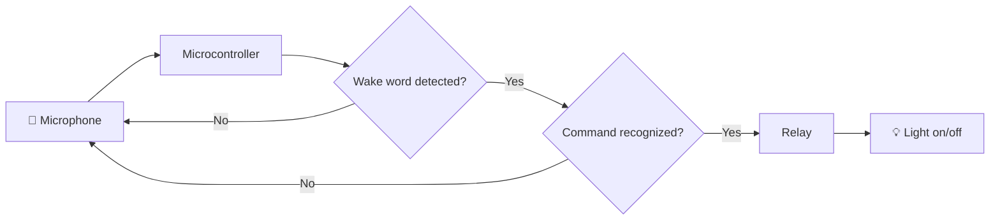

#Jarvis: Voice-Activated Room Light

> A hardware voice-activation project: say **"Hey Jarvis"**, then a command, and a relay switches the lights in my room


<!-- TODO: replace with a short GIF/video of you saying "Hey Jarvis" and the light turning off. This is the single most impactful thing on the page. -->


---

## Overview

I wanted a voice assistant that does one job well and that I fully built and understood, instead of a commercial smart speaker. Jarvis listens for a custom wake word and switches a desk light through a relay.

I built this over the summer as a hands-on engineering project. My focus was the **hardware side**: planning the board, soldering, wiring, and designing a custom enclosure in CAD. The software builds on open-source wake-word and voice-assistant projects (see [Credits](#-credits--what-i-built-vs-what-i-adapted)).

## Highlights

- **Voice activation:** responds to "Hey Jarvis"
- **Hand-soldered hardware:** microcontroller, mic breakout, and relay wired on a prototyping board
- **Switches a real circuit:** a relay toggles the desk light
- **Custom enclosure:** designed in CAD to hide the board and position the mic

---

## Parts

<!-- TODO: fill in the exact model/name for each part (check the labels on the chips and boards). Add one photo per part from your angles. -->

| # | Part | What it does | Model | Photo |
|---|------|--------------|-------|-------|
| 1 | **Microcontroller** | Runs the code and decides when to trigger the light | `[model]` |  |
| 2 | **Microphone breakout board** | Picks up audio for wake-word detection | `[model]` |  |
| 3 | **Relay module** | Safely switches the light circuit on and off | `[model]` |  |
| 4 | **Prototyping board** | Everything is soldered onto this | `[size/type]` |  |
| 5 | **Wiring and solder** | Hand-soldered connections between all components | , |  |
| 6 | **Power supply** | Powers the microcontroller | `[spec]` |  |
| 7 | **3D-printed enclosure** | Houses the board and positions the mic | Custom CAD |  |

###  Build Photos

<!-- Drop your different angles here. Keep the captions specific. -->

| Top view | Close-up of solder joints | Side view |
|----------|---------------------------|-----------|
|  |  |  |

---

## How It Works



1. **Listen:** the mic continuously samples audio.
2. **Match:** the software checks for the wake word "Hey Jarvis".
3. **Act:** a recognized command sends a signal to the relay, which switches the light.

---

## Mechanical Design (CAD)

I designed the enclosure so the project looks like a finished desk accessory instead of a loose board. Goals: protect the electronics, keep the mic exposed and well-positioned, and leave access for the power cable and relay wiring.

<!-- TODO: add 2-3 CAD screenshots (isometric, exploded view, cross-section) -->


- **Software used:** `[CAD program]`
- **Print status:** designed and ready; printing in progress
- **Design decisions:** `[e.g. mic opening placement, ventilation, how the board is mounted]`

---

## Software

The code handles listening for the wake word and triggering the relay. Core logic:

```cpp
// Simplified trigger logic
if (wakeWordDetected && command == "turn the light off") {
    triggerLightRelay(LOW);
}
```

Full source: [`/src`](src/)

---

## Challenges & What I Learned

<!-- TODO: write 3-4 real ones. These are what make a project page stand out. Ideas: -->

- **Soldering and debugging:** `[a joint or wiring problem you had to track down and fix]`
- **Mic placement and noise:** `[how placement affected detection]`
- **Fitting the enclosure:** `[a measurement or tolerance you had to correct]`

## Next Steps

- [ ] Finish printing and assemble the enclosure
- [ ] Add support for more commands (on/off, dimming)
- [ ] `[your own idea]`

---

## Credits & What I Built vs. What I Adapted

**What I did:** planned the board layout, soldered and wired all hardware, designed the CAD enclosure, and tested and integrated the system.

**What I adapted:** the software started from open-source voice-assistant projects on GitHub, and I modified it for this hardware with AI assistance.

- Based on: `[link to the original repo(s)]`
- Co-developed with: `[name(s), if applicable]`

---

## Getting Started

```bash
git clone https://github.com/Rayankh4n/voice-activated-room-light.git
cd voice-activated-room-light
```

1. Wire the components as shown in the build photos above.
2. Flash the code in `/src` to the microcontroller.
3. Say **"Hey Jarvis"**, then your command.

<!-- TODO: add exact wiring (which pin goes where) and the IDE/libraries needed -->

---

**Built by [Rayan Khan](https://github.com/Rayankh4n)**
